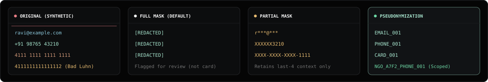
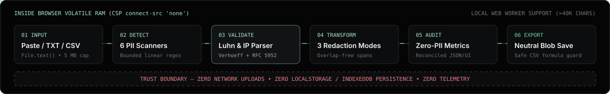

<div align="center">
  

  <br />
  <br />

  **Browser-only PII sanitization and safe handover preparation for disaster relief coordination.**

  [Detection & Modes](#-detection--redaction) • [Local Pipeline](#-local-pipeline) • [Quick Start](#-quick-start) • [Architecture](#-repository-layout) • [Prompt Log](./PROMPT_LOG.md)
</div>

---

Clyro detects, validates, masks, and pseudonymizes sensitive personal identifiers inside browser volatile memory while preserving operational relief fields (`district`, `family_size`, `assistance`, `urgency`, `shelter_status`). **No raw records leave the browser.**

<div align="center">
  
</div>

## ⬡ Detection & Redaction

| Category | Detection & Validation | Canonical Form | Partial Mask | Pseudonym |
|---|---|---|---|---|
| **Email** | Bounded pattern; preserves trailing punctuation | Domain lowercased | `r***@***` | `EMAIL_001` |
| **Indian Phone** | `6–9` 10-digit, `+91`, `0`-trunk, spaces/hyphens | `+91XXXXXXXXXX` | `XXXXXX3210` | `PHONE_001` |
| **IPv4 / IPv6** | Strict `0–255` octets; RFC 4291/5952 parser | RFC 5952 lowercase | `192.X.X.X` | `IP_001` |
| **PAN** | `[A-Z]{5}[0-9]{4}[A-Z]` (case-insensitive) | Uppercase | `XXXXX123X` | `PAN_001` |
| **Aadhaar** | 12 digits (`2–9` start), grouped/ungrouped + Verhoeff flag | 12 digits | `XXXX-XXXX-1234` | `AADHAAR_001` |
| **Credit Card** | 13–19 digits + **Luhn checksum** + repeat-digit guard | Digits only | `XXXX-XXXX-XXXX-1111` | `CARD_001` |

- **Overlap Resolution:** Deterministic priority (`EMAIL > CARD > IP > AADHAAR > PAN > PHONE`) prevents substrings inside validated cards or IPv4-mapped IPv6 addresses from double-counting.
- **Organization Safe Handover (`/app/handover`):** Web Crypto recipient namespaces (`NGO_A7F2_PHONE_001`, `HOSPITAL_B8C3_PHONE_001`) + editable CSV column minimization + local `<2`-record group suppression.
- **Privacy Audit (`/app/audit`):** Reconciled count-only JSON/printable summary with zero raw identifiers, filenames, or lookup maps.
- **Safe CSV Export:** Handles BOM, CRLF/LF, quoted commas, multiline fields, malformed-quote rejection, and optional spreadsheet formula neutralization (`=`, `@`, non-numeric `+`/`-`).

## ⬡ Local Pipeline

<div align="center">
  
</div>

## ⬡ Quick Start

```sh
git clone https://github.com/Swarup-Surwase/Clyro.git
cd Clyro
npm install
npm run dev          # Local server at http://127.0.0.1:5173
```

```sh
npm test             # Vitest unit + React integration suite
npm run typecheck    # TypeScript strict check
npm run lint         # ESLint check
npm run build        # Static production build to dist/
npm run test:e2e     # Playwright E2E, zero-egress & responsive suite
```

Deploy `dist/` to any static host (configured for Vercel via [`vercel.json`](./vercel.json) with SPA rewrites and `connect-src 'none'` CSP headers).

## ⬡ Repository Layout

```text
src/
├── engine/       # Pure TS detectors, Luhn/Verhoeff/IPv6 validators, overlaps, redaction, CSV, audit
├── workers/      # Web Worker for large inputs (>40,000 chars)
├── fixtures/     # Synthetic relief datasets (RFC/payment test values only)
├── hooks/        # Volatile in-memory state store & client router
├── pages/        # Landing (/), Sanitizer (/app), Handover, Audit, Docs, Settings
└── components/   # WebGL fluted-glass intro, interactive demo, inert diff UI
tests/
├── unit/         # Engine & React integration tests
└── e2e/          # Browser workflow, download byte check, zero-egress & viewport tests
```

## ⬡ Privacy Boundaries

- **Pattern Limits:** Names, street addresses, and free-text medical notes are not auto-detected; manual select-and-redact is provided for plain text.
- **Not Anonymization:** Pseudonyms and recipient scopes do not prevent cross-agency linkage when shared operational attributes remain.
- **Environment Scope:** All processing occurs in volatile browser memory (`0` `localStorage` / `sessionStorage` / network uploads), though browser extensions, shared machines, and saved files remain outside application control.

---

<div align="center">
  <sub>Clyro is a local sanitization aid, not a guarantee of complete anonymity or legal compliance.</sub>
</div>
